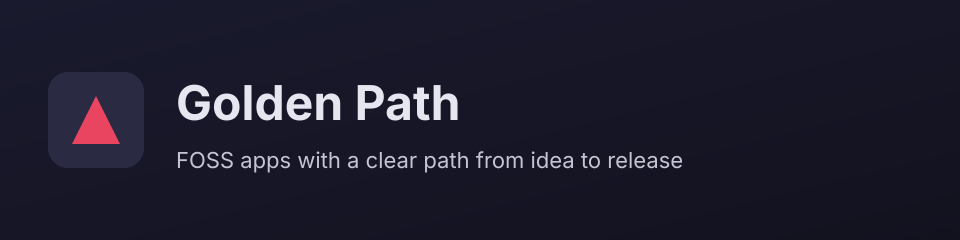
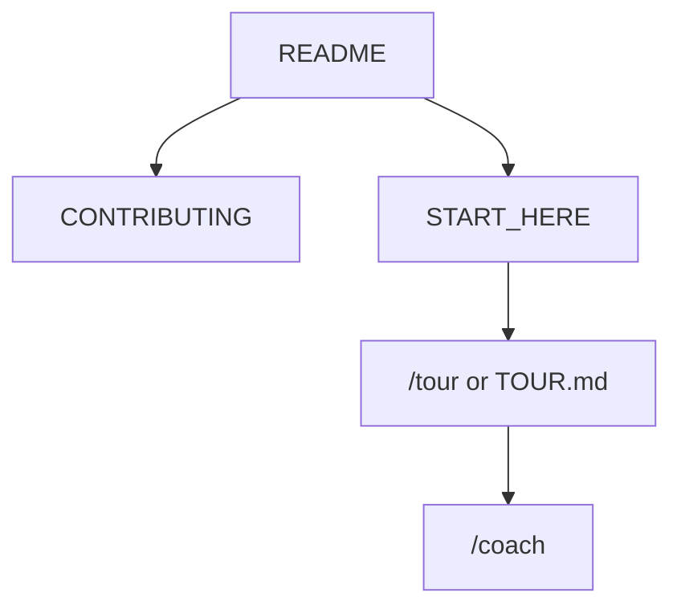

<!-- GENERATED by scripts/generate-project-readme.py — edit branding/product.json -->

  

<h1 align="center">Prism Mail</h1>

<strong>Privacy-first email across web, desktop, and mobile</strong>

  
  
  
  
  
  
  
  
  
  
  
  
  

  
  
  

## Pitch

Prism Mail is a privacy-first multi-provider email client: a web hub for Gmail and IMAP, online desktop clients for Windows, Linux, and macOS, native mobile apps, universal synced whitelist rules, and an optional Proton Bridge connector — without telemetry or plaintext mail hosting.

## Demo

  

**GitHub Pages demo:** [https://edwardlthompson.github.io/prism-mail/](https://edwardlthompson.github.io/prism-mail/)

> Add screenshots or a short demo GIF under `docs/images/` and link them here when available.

## Features

- Web PWA hub for Gmail and generic IMAP/SMTP
- Online-only desktop clients for Windows, Linux, and macOS
- Optional Proton Mail Bridge connector on desktop
- Universal synced settings and image/link whitelist rules
- FairEmail-inspired privacy defaults with no telemetry

## Quick start

1. Clone the repo and open it in Cursor.
2. Read docs/START_HERE.md and docs/PRISM_MAIL_BRIEF.md.
3. Follow BUILD_PLAN.md Sequential; use /coach for the next action.

## For humans

Start with this README, then [`CONTRIBUTING.md`](CONTRIBUTING.md) and [`docs/BEST_PRACTICES.md`](docs/BEST_PRACTICES.md). The first-month playbook is [`docs/FIRST_30_DAYS.md`](docs/FIRST_30_DAYS.md).

## For agents

Read [`docs/START_HERE.md`](docs/START_HERE.md) and [`AGENTS.md`](AGENTS.md). In Cursor type `/tour` or `/bootstrap`. Any other IDE: ask the agent to read [`docs/help/TOUR.md`](docs/help/TOUR.md). `/coach` is the next recommended action.

## Install

Node 22 + npm for the web Golden Path (examples/web). Desktop (Tauri) and mobile clients land in later sprints.

## Usage

Use /bootstrap leftovers for Sprint 0 gates, /build for features, and /verify before merge. Branding lives in branding/product.json and design-tokens/.

## Configuration

Copy [`.env.example`](.env.example) to `.env` for local secrets (never commit `.env`). Stack-specific config lives in the active `examples/` or app root after prune.

## Contributing

See [`CONTRIBUTING.md`](CONTRIBUTING.md). Prefer small PRs; follow Conventional Commits and the BUILD_PLAN labels (`AGENT` / `HUMAN` / `ADB` / `AUTO`). Status markers: 🔲 open · ✅ done · ❌ blocked.

## Security

See [`SECURITY.md`](SECURITY.md). Enable Dependabot alerts and follow [`docs/SECURITY_TRIAGE.md`](docs/SECURITY_TRIAGE.md) for weekly CVE triage.

## License

[MIT License](LICENSE) — see the license file for terms.

## Acknowledgments

Scaffolded with [agent-project-bootstrap](https://github.com/edwardlthompson/agent-project-bootstrap). Brand assets: [`branding/BRANDING.md`](branding/BRANDING.md). Design system: [`docs/DESIGN_GUIDE.md`](docs/DESIGN_GUIDE.md).

## What this is not

- Not a hosted email provider or SMTP/IMAP server.
- Not a telemetry-collecting or ad-supported mail client.
- Not a finished commercial product promise — see active milestones in `BUILD_PLAN.md`.
